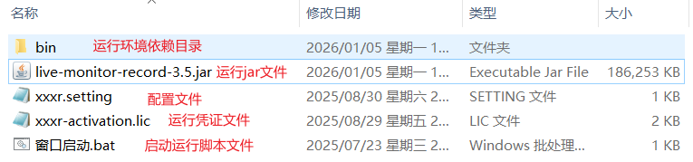
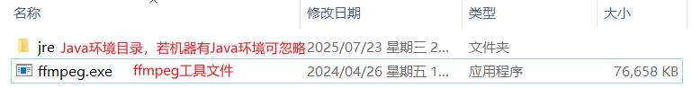
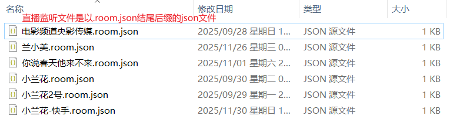
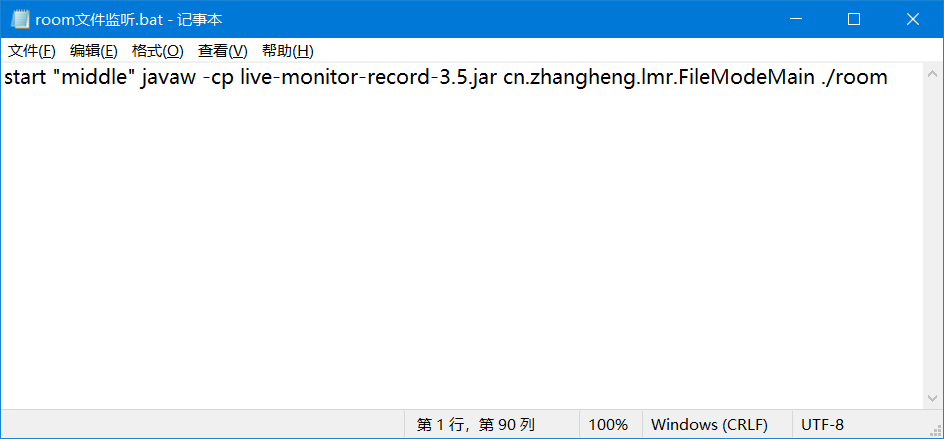
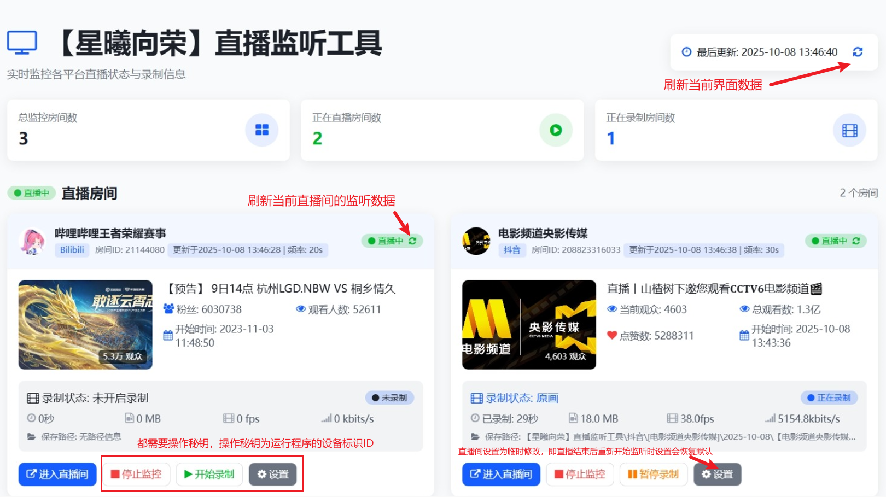
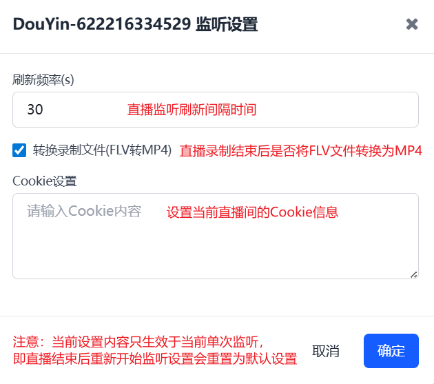

# 【星曦向荣】直播监听工具使用说明

> 面向使用者的操作手册：环境准备、监听文件写法、启动命令、托盘与界面操作。开发/架构细节见 [README.md](README.md)。

## 环境依赖

- **JDK 版本**：JDK 1.8 或更高
- **操作系统**：Java 跨平台语言，理论上支持 Windows / macOS / Linux，目前只验证了 Windows
- **运行目录必须包含**：
    - 配置文件 [xxxr.setting](xxxr.setting)
    - 激活凭证文件 [xxxr-activation.lic](xxxr-activation.lic)（可选，与设备绑定，联系作者获取；没有时进入首次试用期，默认 7 天）
    - ffmpeg 工具（可选，FFmpeg 录制与转 MP4 时需要），下载后把路径配到 `record.ffmpegPath`

## 启动准备

### 运行目录



### 环境依赖目录



### 直播监听文件

创建一个 `room` 目录专门存放直播监听文件，一个直播间对应一个 `.room.json` 文件，程序启动后自动读取目录内全部文件。



参考示例：

```json
{
  "id": "172730382391",
  "name": "麦小鼠大王",
  "platform": "DouYin",
  "isAutoRecord": true,
  "isEnable": true,
  "setting": {
    "delayIntervalSec": 30,
    "isLoop": true,
    "openSubtitle": true,
    "convertFlvToMp4": true
  },
  "savePath": ""
}
```

**字段说明**

| 字段                         |  必填  | 说明                                       |
| -------------------------- | :--: | ---------------------------------------- |
| `id`                       |  ✅   | 直播间 ID，为空会报「直播ID不能为空」并跳过该文件              |
| `platform`                 |  ✅   | 平台枚举：`DouYin` 抖音 / `Bili` B站 / `KuaiShou` 快手 |
| `setting`                  |  ✅   | 配置对象，缺失会导致该文件运行异常被跳过                     |
| `name`                     |  —   | 昵称，程序停止监听时自动回写为实际昵称，可留空                  |
| `isAutoRecord`             |  —   | 是否开播自动录制，默认 `false`                      |
| `isEnable`                 |  —   | 是否启用，默认 `true`，置 `false` 可临时停用该房间        |
| `setting.delayIntervalSec` |  —   | 该房间轮询间隔（秒），不填沿用全局配置                      |
| `setting.isLoop`           |  —   | 该房间下播后是否重新监听，不填沿用全局                      |
| `setting.openSubtitle`     |  —   | 该房间是否记录弹幕（目前仅抖音），不填沿用全局                  |
| `setting.convertFlvToMp4`  |  —   | 该房间录制是否转 MP4，不填沿用全局                      |
| `setting.cookie`           |  —   | 该房间单独使用的 Cookie，会按 `platform` 自动写入对应平台   |
| `setting.xiZhiUrl`         |  —   | 该房间单独的息知推送地址                             |
| `savePath`                 |  —   | 录制目录，程序停止时按昵称重命名并回写，一般无需手改               |

> `setting` 内的四个开关/数值字段不写就沿用 `xxxr.setting` 的全局值；只有显式写 `0` / `false` 才会覆盖（例如 `"delayIntervalSec": 0` 会造成极高频轮询，切勿这样填）。

## 配置文件说明

`xxxr.setting` 为 `key=value` 结构，`#` 为注释，支持 `\uXXXX` 转义，**修改后需重启程序生效**。

**必填三项**（缺失会导致启动校验失败）

| 配置                    | 示例                    | 说明                                       |
| --------------------- | --------------------- | ---------------------------------------- |
| `server.runMode`      | `FILE`                | 运行模式：`COMMAND` 命令行单房间 / `FILE` 读取监听文件（多房间） |
| `record.type`         | `FFMPEG`              | 录制类型，枚举 `JAVA`（原生）/ `FFMPEG`（外部工具），大写    |
| `activation.filePath` | `xxxr-activation.lic` | 激活凭证路径                                   |

> `activation.trialDays`：首次使用试用天数，默认 `7`；激活文件缺失时生效，`0` 或负数表示不开放试用。激活文件存在但过期/损坏时不会退回试用。
>
> 试用提醒：剩 3 天以内文案升级并每小时自检一次、每天最多提醒一次；到期当天提醒"重启后无法启动"，但不打断已在运行的监听；到期后不能再新增监听、重启监听或手动开启录制（开播自动录制照常）。自检间隔可用 `-Dxxxr.trial.checkIntervalMs=毫秒` 覆盖。

**常用项**

| 配置                                       | 默认               | 说明                             |
| ---------------------------------------- | ---------------- | ------------------------------ |
| `server.monitor.port`                    | 8005             | 可视化界面端口，占用时自动累加                |
| `record.isLoop`                          | true             | 下播后是否重新监听                      |
| `record.openSubtitle`                    | true             | 是否记录弹幕（仅抖音）                    |
| `record.FlvToMp4`                        | true             | 录制结束是否转 MP4                    |
| `record.ffmpegPath`                      | `bin/ffmpeg.exe` | FFmpeg 路径                      |
| `monitor.delayIntervalSec`               | 20               | 轮询间隔（秒），须 ≥10                  |
| `notice.xiZhi.url`                       | 空                | 息知推送地址，多个用逗号分隔                 |
| `Cookie.Bilibili` / `Cookie.DouYin` / `Cookie.KuaiShou` | 空                | 平台 Cookie，支持 `file:xxx.txt` 引用 |

完整配置项、进阶项与房间级覆盖规则见 [README 配置说明](README.md#配置说明)。

## 运行启动

- 启动命令

  ```bash
  java -cp live-monitor-record-x.x.jar cn.zhangheng.lmr.FileModeMain [监听文件目录]
  ```

- 示例

  ```bash
  java -cp live-monitor-record-3.6.jar cn.zhangheng.lmr.FileModeMain ./room
  ```

- Windows 后台启动（无命令窗口）

  ```bash
  start "middle" javaw -cp live-monitor-record-3.6.jar cn.zhangheng.lmr.FileModeMain ./room
  ```

  

- Windows 启动脚本（个人使用的完整命令）

  ```bash
  start "live-monitor-record" javaw -Xms256m -Xmx512m -Dsun.java2d.d3d=false -Dsun.java2d.noddraw=true -Dsun.awt.disablegrab=true -Dsun.awt.noerasebackground=true -Dsun.awt.enableExtraMouseInfo=false -Djava.awt.suppressSwingDropSupport=true -Dfile.encoding=utf-8 -Dcom.sun.management.jmxremote -cp live-monitor-record-3.6.jar cn.zhangheng.lmr.FileModeMain ./room
  ```

> `-Dcom.sun.management.jmxremote` 会开启 JMX，可用 JConsole 查看各房间的监听与录制状态。

## 使用说明

- 程序启动成功后，每个直播间都会在系统托盘（任务栏）生成对应图标

  

- 每个房间一个托盘图标，菜单顶部标题为「平台名 + 直播间昵称」

- 托盘图标右键菜单

| 菜单项         | 说明                                       |
| ----------- | ---------------------------------------- |
| 监控界面        | 打开直播监听可视化界面（`COMMAND` 单房间模式不显示此项）        |
| 退出监听        | 结束当前房间的监听任务，进程继续常驻（`COMMAND` 模式则直接退出整个进程） |
| 进入直播间       | 用浏览器打开当前直播间页面                            |
| FLV播放器      | 打开 `FLVPlayer.html`：直播中自动带上当前直播源直接看画面，未开播则打开空白播放器（`COMMAND` 模式不显示此项） |
| 抖音作品解析      | 打开抖音作品解析页 `/DouYinVideoPares.html`，粘贴作品链接即可解析下载信息 |
| 开始录制 / 停止录制 | 二者按录制状态**互斥显示**：未录制时显示「开始录制」，录制中显示「停止录制」，点击即时生效 |
| （悬停提示）      | 鼠标停在图标上会显示直播状态统计与录制进度（清晰度、下载大小、耗时）       |

- 托盘图标三态（`live-common/src/main/resources` 下三张图）

| 状态       | 图标                                       | 触发条件                                     |
| -------- | ---------------------------------------- | ---------------------------------------- |
| 未开播 / 待机 |  | 三条海豚环绕的原始 Logo，无角标；直播间未开播，仅等待轮询          |
| 直播中（未录制） |  | 右下角绿色实心圆角标；已检测到开播，正在监听弹幕/统计              |
| 录制中      |  | 右下角绿环包红心角标；录制结束且仍开播时回到  |

- 左键单击图标：打开该房间的录制保存目录（目录还不存在时打开程序运行目录）

> **停止运行说明：**
>
> 1. **退出整个程序** —— 监控界面右上角的电源按钮（刷新按钮右侧）：点击后先二次确认，再输入**操作秘钥**（即设备标识 ID，与页面其它操作同一套秘钥），校验通过后程序按「停全部监听 → 关浏览器 → 收线程池 → 停 HTTP/cpolar 服务」顺序优雅退出；
> 2. **接口方式退出** —— `action/exit` 是私密接口，先用 `GET action/auth?actionKey=<设备标识 ID>` 换取秘钥令牌，再带 `Authorization: Bearer <令牌>` 调用 `GET/POST action/exit`，适合远程或脚本调用；
> 3. **只停单个房间** —— 托盘菜单「退出监听」，进程继续待命，可随时再新增或恢复监听；
> 4. 使用 FFmpeg 录制时，**优先用界面/接口正常退出**，直接 `taskkill` 结束 JVM 可能残留 `ffmpeg.exe` 子进程。

## 直播监听可视化界面说明

- 界面操作说明

  

- 设置操作说明

  

- 访问方式：浏览器打开 `http://localhost:8005`（端口被占用时自动向后累加，以启动日志中的实际端口为准），**操作秘钥为设备标识 ID**
- 设备标识 ID 获取：

  ```bash
  java -cp live-monitor-record-3.6.jar cn.zhangheng.record.activation.ActivationUtil
  pause
  ```

- **远程访问（页面托管在 GitHub Pages + cpolar 映射后端）**

  - 页面地址：`https://你的用户名.github.io/项目名/?url=https://xxxx.cpolar.cn`（或 `?redirect=配置键`，由 `config.json` 里的 `redirectUrl` 决定后端地址）
  - **陌生人打开页面就能看到实时监视面板**（房间列表、直播/录制状态、观众统计），不会一进来就被要求输秘钥；录制路径、Cookie、通知地址等隐私字段对匿名访问自动隐藏
  - 真正需要秘钥的是**敏感操作**：新增/修改/删除房间、开始或停止监听、关闭浏览器实例、录制文件下载、监听回收站、退出程序——点这些按钮时才会弹「操作验证」，输入秘钥后勾选「记住秘钥」即可；刷新房间属只读操作，普通令牌即可完成
  - 抖音作品解析页（`api/videoParsing`）**完全公开**，任何人无需秘钥即可使用；同一 IP 每分钟最多 3 次（`server.api.parsePerMinute` 可调，`0` 为不限），超限会提示「解析请求过于频繁，请 N 秒后再试」
  - 接口按三级鉴权：**公开**（页面、`info/*`、埋点、抖音作品解析）不需要令牌；**普通**（房间列表、刷新、链接解析）用 `action/token` 公开签发的普通令牌；**私密**（写操作、录制文件、回收站、埋点日志、退出）必须用 `action/auth?actionKey=<设备标识 ID>` 换取的秘钥令牌
  - 普通令牌有效期 30 分钟（`server.auth.publicTokenExpireSec` 可调），秘钥令牌有效期 2 小时（`server.api.expireSec` 可调），页面都会自动续期
  - 想彻底关闭公开签发（普通接口也必须先换秘钥令牌），在 `xxxr.setting` 里设 `server.auth.publicTokenEnabled=false`
  - 跨站场景靠 `Authorization: Bearer` 令牌鉴权，不依赖 Cookie，因此浏览器拦截第三方 Cookie 也不影响使用
  - 录制文件下载链接会自动带上秘钥令牌的 `token` 参数，可直接右键另存

## 其他说明

- 修改 `xxxr.setting` 或任意 `*.room.json` 后需重启监听才生效（删除/启用房间可在可视化界面操作，无需重启）
- 直播间 ID 获取方法：进入直播间复制链接地址
    - 抖音：`https://live.douyin.com/622216334529?...` → ID 为 `622216334529`
    - 快手：`https://live.kuaishou.cn/u/yst30429340` → ID 为 `yst30429340`
- 弹幕记录（`record.openSubtitle` / 房间级 `openSubtitle`）目前仅抖音有效，且礼物信息需要配置账号 Cookie
- 录制的文件超过 15G 或直播切换清晰度会自动分段，录制结束后按 `record.FlvToMp4` 决定是否转 MP4
